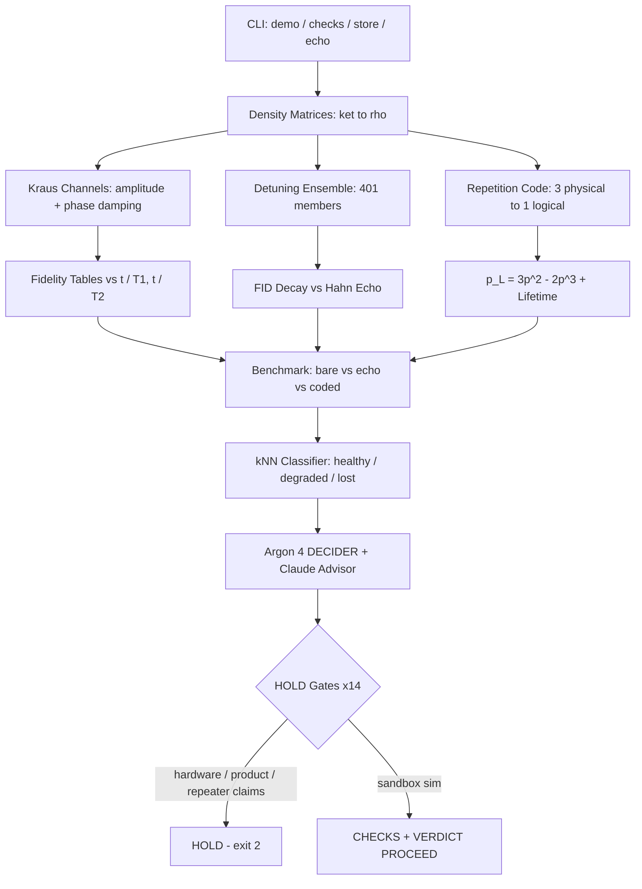
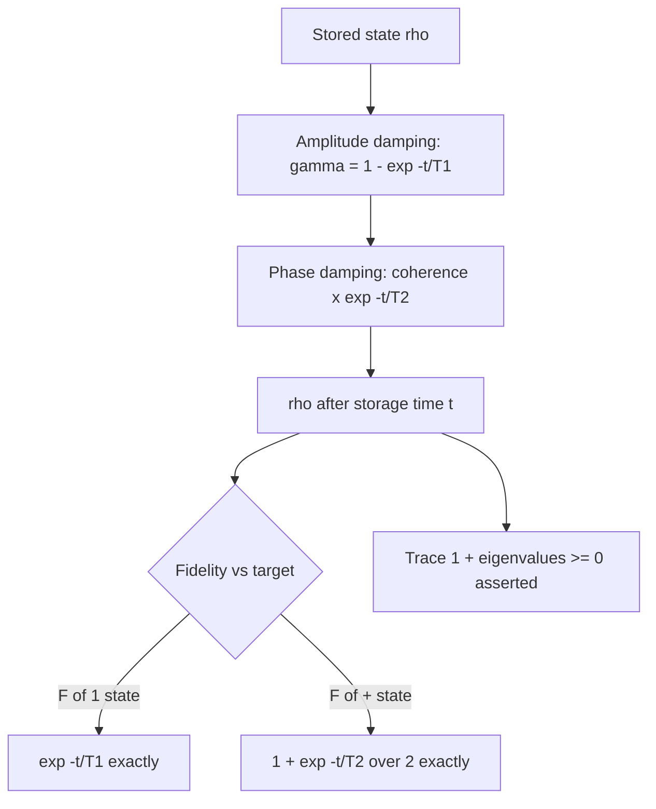
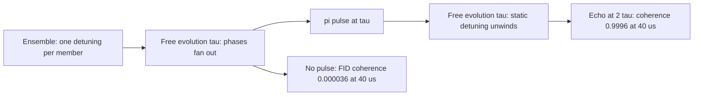
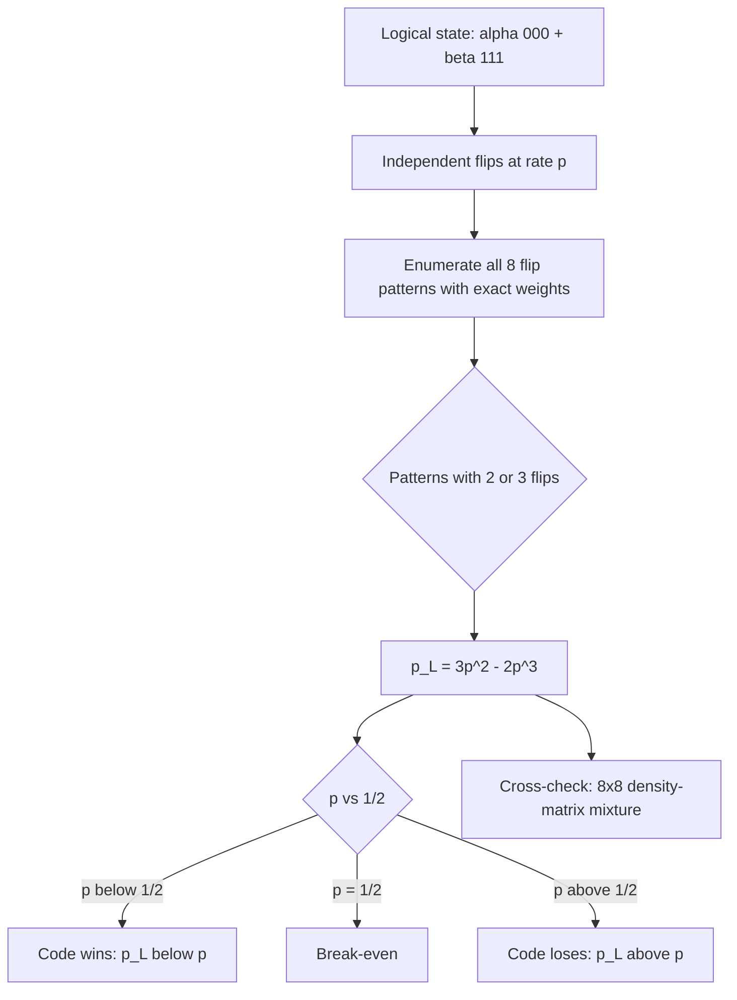
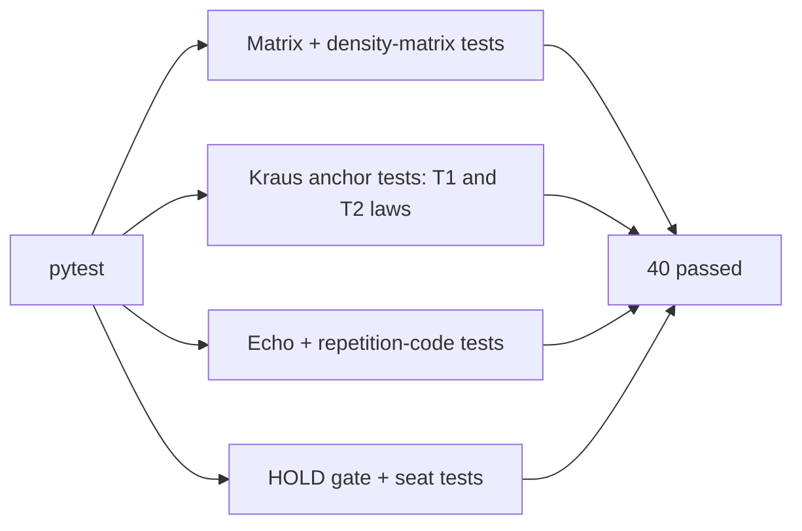
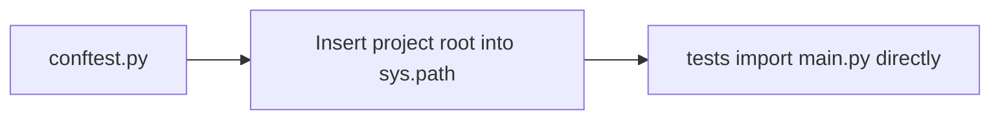
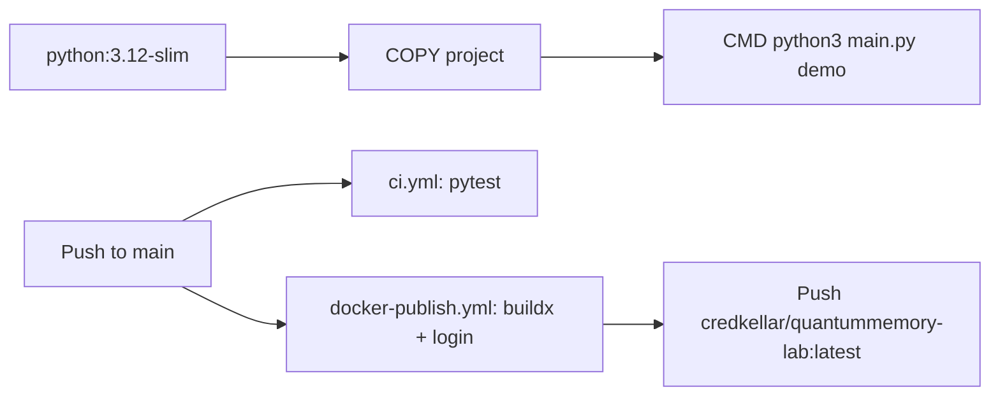

# QuantumMemory-Lab 🧠⚛️

**Quantum Memory Lab** — by Darion Kellar

QuantumMemory-Lab is an **educational quantum memory engine** in ONE pure-Python file. It stores single-qubit states as **density matrices**, lets the two great enemies of storage — **amplitude damping (T1)** and **phase damping (T2)** — act on them as exact **Kraus channels**, and then prices the two classic defences honestly: a **Hahn spin echo** that refocuses slow detuning noise, and a **3-qubit repetition code** whose logical error rate is the polynomial **p_L = 3p² − 2p³**, enumerated pattern by pattern.

The honest scope is the whole point, and it is stated everywhere:

- ✅ **What it computes:** exact channel arithmetic on 1–3 qubits. Fidelities, coherences, logical error rates, and lifetimes are derived from the density matrices and pattern weights in the code — never quoted from a datasheet.
- 🚫 **What it can never claim:** a real memory. Every device number (T1 = 100 µs, T2 = 80 µs, detuning spread, error timescale) is a **labelled teaching value**. No qubit was stored, no coherence record was set, and no storage product exists.

Every hardware / product / network / repeater / satellite / breakthrough use sits behind a permanent HOLD gate (14 total). 🔒

[](https://github.com/kimanicollier44-cmyk/QuantumMemory-Lab/actions/workflows/ci.yml)
[](https://github.com/kimanicollier44-cmyk/QuantumMemory-Lab/actions/workflows/docker-publish.yml)

> ℹ️ These are the **live** workflow badges for this repo. They activate as soon as the `ci.yml` and `docker-publish.yml` files from the paste pack are pasted into `.github/workflows/` — until then they have nothing to report yet.

## 🧰 Tech Stack Badges & Full Architecture Tech Stack

### 💻 Core Programming Languages & Core Systems


- 🐍 Python 3.12, pure standard library (`hashlib`, `itertools`, `json`, `math`, `sys`) — zero dependencies, zero network, deterministic (double-run byte-identical)
- 🔢 Density matrices from scratch: 2×2 (and 8×8) complex matrix helpers — multiply, add, scale, dagger, Kronecker product, trace, closed-form eigenvalues — no numpy anywhere, so every amplitude can be recomputed by hand
- 🌊 Kraus channels implemented directly: a channel is a list of operators K with Σ K†K = I (asserted in the checks), applied as ρ → Σ K ρ K†
- 🔁 Repetition code by enumeration: all 8 flip patterns weighted exactly for both the bit-flip and phase-flip codes, cross-checked against an 8×8 density-matrix mixture
- 🧠 TinyML kNN memory-health classifier (from scratch, stdlib): healthy / degraded / lost from (fidelity, t/T2, p_L), labels generated by the lab's own health policy
- 🪑 Council seats: Gemini Argon 4 DECIDER (names-only, tighten-only) + Muse advisor (never overrides HOLD) + Google Flow plan-only (rendered = False, live = 0)

### ⛓️ Web3 & Infrastructure

- 🚫 **Not applicable — honestly.** No blockchain, no Web3, no quantum network, no repeaters, no key distribution: real quantum-network and repeater deployment are permanent HOLD gates here, and the lab itself is one offline Python file. No fake badges here.

### ⚙️ Platform Support & Hardware Architecture


- 🖥️ Pure Python — runs anywhere Python 3.12+ runs (Linux, macOS, Windows), plus the `python:3.12-slim` Docker image
- 🔒 No real quantum hardware is touched, ever: hardware, coherence-record, and fault-tolerance claims are permanent HOLD gates (see the gate table below)

### ⚡ Low-Level Infrastructure & Performance

- 🚫 **No low-level code — honestly.** No C, no C++, no GPU, no compiled extensions: this is one interpreted Python file on purpose, so every Kraus operator, ensemble average, and pattern weight can be read, checked, and diffed. Performance here means honest algorithms — closed-form 2×2 eigenvalues, a fixed 401-member ensemble grid, and an 8-pattern enumeration — all deterministic and byte-identical between runs.

### 🛠️ DevOps & Build Tools


- 🐳 Docker (`python:3.12-slim`), GitHub Actions CI + Docker Publish (delivered in the paste pack)
- 🎯 Target image: `credkellar/quantummemory-lab:latest`
- 🧪 Tests: `pytest` (40 tests) + the built-in CHECKS suite (71 checks) in `main.py`

### ☁️ Cloud Providers

- 🚫 **None — honestly.** No cloud provider is used or needed: the lab runs fully offline on your own machine or in a local Docker container. Docker Hub appears only as the registry the publish workflow pushes the image to.

## What this does?

1. 🗄️ **Store a qubit** — pick a state (|0⟩, |1⟩, |+⟩, or a tilted state at 0.7 rad) and build its density matrix ρ = |ψ⟩⟨ψ| from scratch. Trace, Hermiticity, purity, and eigenvalues are verified before anything decays.
2. ⚡ **Amplitude damping (T1)** — the energy-leak channel, Kraus operators with γ = 1 − exp(−t/T1). The excited state drains into the ground state: F(|1⟩) = exp(−t/T1) exactly, and the checks pin it to 1e-9.
3. 🌫️ **Phase damping (T2)** — the phase-loss channel. Populations are untouched; the coherence shrinks by exp(−t/T2), so a stored |+⟩ follows the law **F = (1 + exp(−t/T2)) / 2** — 0.6839 at t = T2 — matched against the Kraus computation, not quoted.
4. 📉 **Fidelity tables** — both channels act together and the lab prints fidelity vs time for every stored state. The tilted state's fidelity decays, then relaxes toward its |0⟩ overlap (cos²(θ/2)) as damping pumps it home — the table shows that too.
5. 🌀 **Free-induction decay** — quasi-static detuning: 401 ensemble members, each holding one detuning from a Gaussian of width σ = 0.15 rad/µs (labelled). Their phases fan out and the ensemble coherence dies on the **T2\* = 9.43 µs** scale — 0.000036 left at 40 µs.
6. 🔂 **Hahn echo** — a π pulse at τ flips every member's phase accumulation, so each static detuning cancels *exactly* at 2τ. Only the labelled slow drift survives: echo coherence at 40 µs is **0.9996** where FID kept 0.000036.
7. 🗳️ **Repetition code** — three physical qubits hold one logical qubit (α|000⟩ + β|111⟩, or α|+++⟩ + β|---⟩ for phase flips). Majority vote corrects any single flip; failure needs ≥ 2 flips, so **p_L = 3p² − 2p³**, enumerated pattern by pattern and cross-checked with an 8×8 density-matrix mixture.
8. ⚖️ **Break-even, asserted** — the code wins exactly when p < 1/2 (p = 0.1 → p_L = 0.028, a ×3.57 gain; p = 0.01 → 0.000298, ×33.56), ties at p = 1/2, and *loses* above it. The checks assert all three regimes — error correction is not magic, it is a bet you win only below break-even.
9. ⏳ **Lifetime, computed** — under the labelled flip model p(t) = (1 − exp(−t/50 µs)) / 2, storage fidelity falls to 0.9 at **11.16 µs bare vs 24.85 µs coded — a ×2.23 extension** found by bisection on the exact formulas. The benchmark table also shows the honest crossover: as p(t) saturates toward 1/2, the code's edge fades.
10. 🏷️ **Health classifier + seats + checks** — a from-scratch kNN labels memory scenarios healthy / degraded / lost with labels generated by the lab's own health policy, watched over by the Argon 4 DECIDER (sha256 trace), Muse advisor, Google Flow plan-only, and a built-in CHECKS suite (71 checks).

## 🗺️ How it works — diagram per script

### `main.py` — the whole lab



### `main.py` § Kraus channels — how a stored state decays



### `main.py` § spin echo — refocusing the detuning fan



### `main.py` § repetition code — majority vote as a polynomial



### `tests/test_main.py` — verification



### `conftest.py` — test path setup



### `Dockerfile` + CI flow — container & publish



## Why is this cool?

1. 🌊 The channels are **built, not imported**: Kraus operators, completeness Σ K†K = I, and the ρ → Σ K ρ K† update are readable Python you can audit line by line — no numpy black box.
2. 🎯 The T2 law is **derived, then caught**: F(|+⟩) = (1 + exp(−t/T2)) / 2 falls out of the Kraus operators, and the checks demand the computed density matrix match it to 1e-9 at five different times.
3. 🔂 The echo **earns its rescue**: the same ensemble that loses its coherence by 40 µs (0.000036) gets it back (0.9996) from one π pulse — with the static-cancellation exact and only a labelled drift allowed to leak.
4. 🗳️ The code's error rate is **enumerated, not quoted**: all 8 flip patterns are weighted one by one, in both the bit-flip and phase-flip bases, and an independent 8×8 density-matrix mixture has to agree.
5. ⚖️ Break-even is a **theorem with a receipt**: the checks assert the code wins below p = 1/2, ties at 1/2, and loses above it — the most honest sentence in error correction, enforced by tests.
6. ⏳ The lifetime extension is **solved, not stated**: bisection on the exact bare and coded fidelity curves finds the 0.9-crossing times (11.16 vs 24.85 µs) instead of printing a marketing multiplier.
7. 📉 The benchmark shows the **crossover**: the coded memory's edge is real early and fades as the physical rate saturates toward 1/2 — the table refuses to cherry-pick the flattering rows.
8. 🌀 T2\* and T2 are **kept apart**: the ensemble's inhomogeneous T2\* (9.43 µs) vs the homogeneous T2 (80 µs) distinction — the one textbooks blur — is two different computed objects here.
9. 🚫 The lab's proudest feature is a **refusal**: `coherence_record_claim` and `hardware_memory_claim` are permanent HOLD gates, so the tool can never be quoted as a device result.
10. 🎯 Deterministic end to end: fixed ensemble grid, closed-form anchors, no randomness, no wall clock — run it twice, get byte-identical output.

## What problems this solves?

1. ❌ **Problem:** "Decoherence" taught as a vibe — states just "fade". ✅ **Solution:** Two named channels with exact Kraus operators; the fade is a matrix you can print, and its anchors (exp(−t/T1), (1 + exp(−t/T2)) / 2) are asserted.
2. ❌ **Problem:** T2 and T2\* used interchangeably. ✅ **Solution:** The lab computes both separately — homogeneous phase damping (T2 = 80 µs) vs the detuning ensemble's free-induction decay (T2\* = 9.43 µs) — and shows the echo bridging them.
3. ❌ **Problem:** Spin echo explained as "it reverses noise, trust me". ✅ **Solution:** The ensemble average is computed member by member; static detuning cancels exactly in the arithmetic, and the only surviving loss is the labelled drift term, printed.
4. ❌ **Problem:** Error correction sold as free reliability. ✅ **Solution:** p_L = 3p² − 2p³ is enumerated and plotted against p itself — below 1/2 it helps, at 1/2 it breaks even, above 1/2 it hurts, and the tests enforce all three.
5. ❌ **Problem:** Logical error rates copied from textbooks without derivation. ✅ **Solution:** The polynomial is rebuilt from the 8 pattern weights in code, then cross-checked by an independent density-matrix mixture — two routes, one number.
6. ❌ **Problem:** "Error correction extends memory lifetime" with no number attached. ✅ **Solution:** The 0.9-fidelity crossing is solved by bisection for both memories: 11.16 µs bare, 24.85 µs coded, ×2.23 — under a labelled error model stated in the open.
7. ❌ **Problem:** Benchmarks that only show the flattering regime. ✅ **Solution:** The storage benchmark runs to 80 µs where the saturating flip model erases the code's advantage, and the crossover is printed in the same table as the wins.
8. ❌ **Problem:** Simulation parameters smuggled in as if they were measurements. ✅ **Solution:** Every device number is named LABELLED wherever it appears — docstring, demo, README, and overview — and record/hardware claims are HOLD gates.
9. ❌ **Problem:** Memory tools that need a quantum SDK, a server, or an account. ✅ **Solution:** One offline Python file; the matrices, channels, ensemble, code, and classifier all run locally with zero dependencies.
10. ❌ **Problem:** Demo data that only shows the happy path. ✅ **Solution:** The classifier scenarios deliberately land healthy, degraded, and lost memories, and the code demo includes the regime where the code *loses* — every outcome is exercised, not just advertised.

## How to install this?

1. 📋 Clone or download this project folder:

```bash
git clone https://github.com/kimanicollier44-cmyk/QuantumMemory-Lab.git
```

2. 🐍 Make sure Python 3.12+ is installed: `python3 --version`
3. ▶️ Run the full demo + checks (no arguments needed):

```bash
python3 main.py
```

4. 🧪 Run the test suite:

```bash
pip install pytest
python3 -m pytest -q
```

5. 🎛️ Try the other commands:

```bash
python3 main.py checks    # 71 built-in checks
python3 main.py store     # fidelity vs time tables for the stored states
python3 main.py echo      # FID vs Hahn echo coherence report
python3 main.py code      # repetition code: p_L table + lifetime extension
python3 main.py benchmark # bare vs echo vs coded storage benchmark
python3 main.py classify  # kNN memory-health classifier report
python3 main.py brains    # Argon 4 + Muse + Flow seats
python3 main.py holds     # list all 14 HOLD gates
python3 main.py hold-demo # exits 2 - gated actions stay HOLD
```

6. 🐳 Or run it in Docker:

```bash
docker pull credkellar/quantummemory-lab:latest
docker run --rm credkellar/quantummemory-lab:latest
```

## Requirements

- 🐍 Python 3.12 or newer
- 📦 Dependencies: **none** (standard library only)
- 🌐 Network: **none** — fully offline
- 🧪 For tests only: `pytest`
- 🐳 Optional: Docker

## FULL project structure tree

```text
quantummemory-lab/
├── main.py                  # the whole lab: density matrices, Kraus channels, echo ensemble, repetition code, benchmark, classifier, seats, HOLD gates
├── conftest.py              # puts the project root on sys.path for tests
├── tests/
│   └── test_main.py         # 40 pytest tests: matrices, channel anchors, echo, code polynomial, lifetime, classifier, gates, seats
├── assets/
│   └── cover.png            # README cover image (2736 x 912)
├── .github/
│   └── workflows/
│       ├── ci.yml           # paste-in from the workflow pack
│       └── docker-publish.yml # paste-in from the workflow pack (tag: credkellar/quantummemory-lab:latest)
├── Dockerfile               # python:3.12-slim, runs the demo
├── .gitignore               # __pycache__/, .pytest_cache/, *.pyc
└── README.md                # this file
```

> 📦 Delivered separately as paste packs (not in this tree): `.github/workflows/ci.yml` + `docker-publish.yml`, and the Docker Hub pack (100-char description, 350-char About, overview, categories).

## 🔒 HOLD gates — all 14, permanent

| # | Gate | What stays held |
|---|------|-----------------|
| 1 | `hardware_memory_claim` | No claiming this lab builds, simulates, or certifies real quantum memory hardware |
| 2 | `quantum_storage_product_claim` | No quantum storage product, service, or commercial offering claim |
| 3 | `real_key_storage_claim` | No storing real cryptographic keys, QKD keys, or secrets in a quantum memory |
| 4 | `fault_tolerant_computation_claim` | No claiming fault-tolerant quantum computation has been achieved |
| 5 | `coherence_record_claim` | No coherence-time records or measured device performance claims |
| 6 | `error_correction_breakthrough_claim` | No QEC breakthrough, threshold-theorem, or record logical-qubit claims |
| 7 | `quantum_network_deployment` | No deploying a real quantum network, teleportation link, or entanglement distribution |
| 8 | `quantum_repeater_deployment` | No quantum repeater deployment or field-trial claim |
| 9 | `satellite_quantum_link_claim` | No satellite, space, or long-distance quantum memory link claim |
| 10 | `medical_data_storage_claim` | No storing real medical, genomic, or patient data |
| 11 | `financial_record_storage_claim` | No storing real financial records, trades, or ledger data |
| 12 | `military_defense_use` | No military, weapons, surveillance, or defense memory application |
| 13 | `classified_data_storage_claim` | No storing classified, government, or intelligence data |
| 14 | `commercial_advantage_claim` | No commercial, speed, or quantum-advantage claim for any memory system |

🧑‍⚖️ **Council seats:** Gemini Argon 4 Extended Thinking — DECIDER (names-only, tighten-only, MAP → MODEL → STRESS → DECIDE, sha256 trace, `can_override_hold = False`) · Muse — advisor (`can_override_hold = False`) · Google Flow — plan-only (`rendered = False`, `live = 0`).

✅ **Verification:** pytest **40 passed** (project + clean copy) · built-in CHECKS **71/71** · double-run output **byte-identical** · `hold-demo` exits **2** · `main.py` **836 lines**, pure stdlib, zero network.

## 🧒 5th-grade English section

Imagine you write a secret note and put it in a glass box. Two things go wrong over time. The ink slowly runs downhill and pools at the bottom (that is **T1** — the note sags). And the glass gets foggy, so the words blur even though the ink is still there (that is **T2** — the note smears). 📝

- **This lab is a stopwatch for the note.** It does the math for exactly how saggy and how blurry the note gets, minute by minute — no guessing.
- **The echo trick:** suppose a whole class reads the note, and everyone wears slightly wrong glasses, so everyone sees it a little differently and the class's memory of the note falls apart fast. Halfway through, everyone flips their glasses upside down. The same wrongness now *un-blurs* what it blurred, and at the end the class remembers the note almost perfectly. That flip is the **spin echo**. 🤓
- **The three-copy trick:** write the note three times and keep all three copies. If one copy gets a smudge, the other two outvote it. The copies only fail if *two* get smudged at once — and the lab counts exactly how often that happens. It works only when smudges are rare: if every copy is more likely smudged than not, voting makes things *worse*. There is an exact break-even point, and the lab proves where it is. 🗳️
- Here is the most important part: **the numbers in this lab are practice numbers.** Nobody really stored a qubit here. It is a math toy that teaches how real quantum memories fight forgetting — the real machines are still somebody else's hard work. 🧑‍🔬

---

MIT © 2026 Darion Kellar · QuantumMemory-Lab — educational simulation only 🧠
